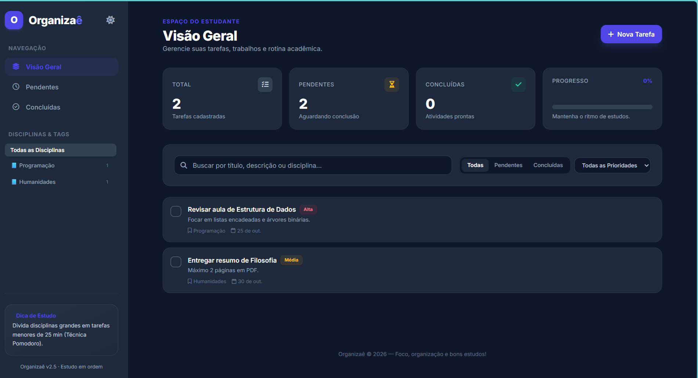

# Organizaê 📚

Organizaê é um organizador de tarefas e estudos desenvolvido como projeto acadêmico do curso de Análise e Desenvolvimento de Sistemas.

## 🎯 Objetivo

Facilitar a organização da rotina de estudantes, permitindo acompanhar tarefas, trabalhos e atividades acadêmicas em um único lugar.

## 👥 Público-alvo

Estudantes que precisam organizar suas atividades, acompanhar prazos e visualizar suas tarefas concluídas.

## ✨ Funcionalidades

- Cadastro de tarefas.
- Edição e exclusão de tarefas.
- Marcação de tarefas concluídas.
- Pesquisa de atividades.
- Filtros por situação.
- Indicador de progresso.
- Armazenamento de dados com LocalStorage.

## 🛠️ Tecnologias utilizadas

- HTML
- CSS
- JavaScript
- LocalStorage

## 🎨 Interface e experiência do usuário

O projeto utiliza uma interface com tons escuros e detalhes em roxo. A organização visual e a identidade de cores foram elaboradas com auxílio de sugestões do ChatGPT.

## 🧠 Processo de desenvolvimento

As funcionalidades foram definidas considerando as necessidades de estudantes que desejam organizar sua rotina acadêmica.

O ChatGPT foi utilizado como ferramenta de apoio, contribuindo com sugestões para a identidade visual, organização da interface e desenvolvimento.

## 💬 Feedback

O projeto foi apresentado a amigos e familiares, que demonstraram uma reação bastante positiva.

## 🌐 Acesse o projeto

[Organizaê — Aplicação online](https://trajanoguto844-sketch.github.io/organizaee/)

## 📸 Visualização

## 📚 Aprendizados

Durante o desenvolvimento, pratiquei conceitos de programação web, organização de funcionalidades, armazenamento local e construção de interfaces digitais.
